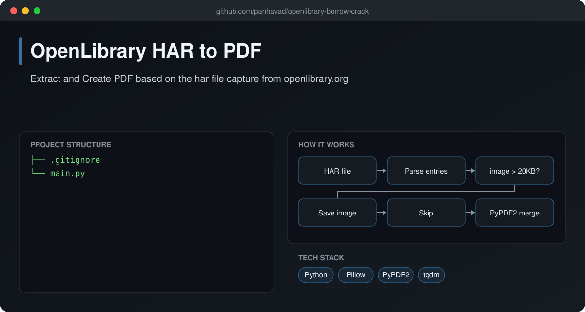
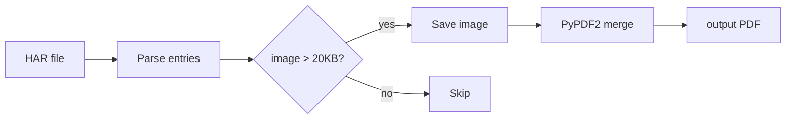

# OpenLibrary HAR to PDF

  [](https://github.com/panhavad/openlibrary-borrow-crack/releases/latest)

A Python tool that **extracts page images from a browser HAR capture** and merges them into a single PDF. Built as an educational exercise on HAR files, base64 images and PDF generation. Only use it with content you have the right to keep.



## Features

- Parses HAR (HTTP Archive) JSON
- Decodes base64 images and skips tiny assets
- Saves images into a timestamped folder
- Merges pages into one PDF with progress bars

## How it works



## Getting started

```bash
pip install pillow tqdm PyPDF2
python main.py
```

## Download

Grab the packaged source from the [latest release](https://github.com/panhavad/openlibrary-borrow-crack/releases/latest).

## Tech stack

- Python
- Pillow
- PyPDF2
- tqdm

## Project structure

```text
openlibrary-borrow-crack/
├── docs/
├── .gitignore
├── main.py
└── README.md
```
